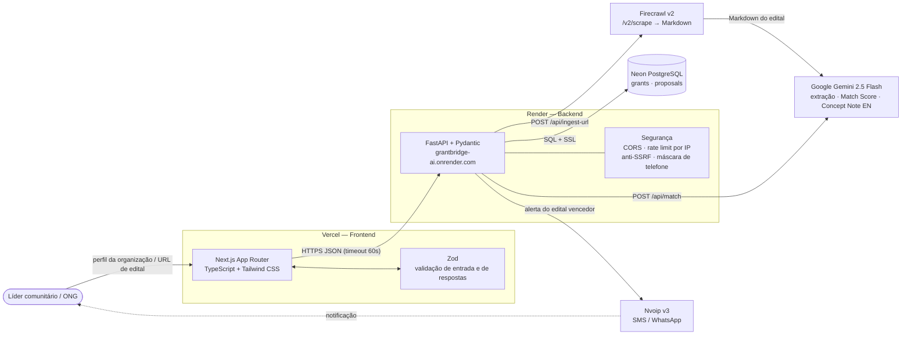

# 🌱 GrantBridge AI

> **Conectando pequenas ONGs, cooperativas e iniciativas ambientais locais do Brasil aos bilhões de dólares em fundos climáticos internacionais.**

Projeto desenvolvido para o **Hack Brasil 2026** na trilha **Meio ambiente & economia verde**.

---

## 🎯 O Problema

Bilhões de dólares em fundos climáticos e editais internacionais (ONU/UNDP, Global Greengrants Fund, Rainforest Trust, Blue Action Fund, The Rufford Foundation, entre outros) são destinados à preservação ambiental e à economia verde. No entanto, organizações locais brasileiras enfrentam três grandes barreiras:

1. **Editais fragmentados** em dezenas de portais internacionais em língua inglesa.
2. **Barreira linguística e técnica** na elaboração de *Project Concept Notes* alinhadas aos critérios de doadores globais e ODS da ONU.
3. **Falta de recursos** para contratar consultores especializados e acompanhar novas chamadas em tempo real.

## 💡 A Solução

O **GrantBridge AI** automatiza toda a ponte entre a iniciativa ambiental brasileira e o financiador internacional:

1. **Raspagem ao Vivo (`Firecrawl v2`):** Ingere qualquer URL de edital internacional em Markdown e extrai título, financiador, país, valor, prazo e escopo via **Gemini 2.5 Flash**.
2. **Base Persistente (`Neon PostgreSQL`):** Armazena editais internacionais (com seed automático de 6 fundos reais) e o histórico de propostas geradas.
3. **Match Score + Proposta em Inglês (`Gemini 2.5 Flash`):** Compara o perfil da organização brasileira com os editais do banco, calcula o **Match Score (0–100)** e redige uma *Project Concept Note* completa em inglês (*Executive Summary*, *Local Environmental Impact in Brazil*, *Alignment with Donor Goals*, *Budget Breakdown* e *UN SDGs*).
4. **Alerta Instantâneo (`Nvoip API v3`):** Notifica o líder comunitário via SMS/WhatsApp assim que o edital vencedor e a proposta ficam prontos (com fallback seguro caso a conta esteja em modo demo/saldo zero).

---

## ⚡ Como Testar em 1 Minuto (Avaliadores Hack Brasil 2026)

> Nenhuma instalação necessária. O backend roda no plano gratuito do Render: a **primeira requisição pode levar até ~50s** (cold start). As seguintes respondem em poucos segundos.

1. **Acorde a API (10s):** abra [`https://grantbridge-ai.onrender.com/api/health`](https://grantbridge-ai.onrender.com/api/health) e confirme `"status": "ok"` com o estado de Neon PostgreSQL, Firecrawl v2, Gemini 2.5 Flash e Nvoip v3.
2. **Abra o app (10s):** acesse [`https://grantbridge-ai-theta.vercel.app`](https://grantbridge-ai-theta.vercel.app) e veja os editais climáticos internacionais carregados do Neon.
3. **Gere um Match + Concept Note (30s):** cole um perfil de organização, por exemplo:
   > *Cooperativa de agricultoras familiares no sul do Pará que recupera áreas degradadas com sistemas agroflorestais e viveiros de mudas nativas, beneficiando 120 famílias.*

   Opcionalmente informe um WhatsApp com DDD para receber o alerta via Nvoip v3. O app retorna o **Match Score (0–100)**, a justificativa em português e a *Project Concept Note* completa em inglês.
4. **(Opcional) Raspagem ao vivo (10s):** clique em **Adicionar Edital** e cole a URL pública de uma chamada internacional (ex.: `https://www.rufford.org/`). O Firecrawl v2 raspa a página e o Gemini estrutura o edital no banco.

Via terminal:

```bash
curl -s https://grantbridge-ai.onrender.com/api/health
curl -s https://grantbridge-ai.onrender.com/api/grants
curl -s -X POST https://grantbridge-ai.onrender.com/api/match \
  -H "Content-Type: application/json" \
  -d '{"ong_profile": "Cooperativa de agricultoras familiares no Pará que recupera áreas degradadas com agrofloresta."}'
```

---

## 🏗️ Arquitetura



**Fluxo de ingestão (`POST /api/ingest-url`):** URL validada contra SSRF → Firecrawl v2 raspa a página em Markdown → Gemini 2.5 Flash extrai título, financiador, país, valor, prazo e escopo → edital salvo em `grants` no Neon.

**Fluxo de match (`POST /api/match`):** perfil validado por Zod (frontend) e Pydantic (backend) → editais carregados do Neon → Gemini 2.5 Flash calcula o Match Score e redige a Concept Note em inglês → Nvoip v3 envia o alerta → proposta salva em `proposals` (telefone mascarado no histórico público).

### Stack de Produção

| Camada | Tecnologia | Hospedagem / Provedor |
|---|---|---|
| **Frontend Web** | Next.js (App Router), TypeScript, Tailwind CSS, Zod, Lucide React | **Vercel** |
| **Backend API** | Python FastAPI, Pydantic, httpx | **Render** (`https://grantbridge-ai.onrender.com`) |
| **Banco de Dados** | PostgreSQL Serverless (`psycopg 3` + SSL) | **Neon PostgreSQL** |
| **Web Scraping** | Firecrawl API v2 (`/v2/scrape`) | **Firecrawl** |
| **Inteligência Artificial** | Google Gemini 2.5 Flash | **Google AI** |
| **Notificações** | Nvoip API v3 (`X-Nvoip-Api-Key`) | **Nvoip** |

### Estrutura do Repositório

```text
grantbridge-ai/
├── package.json              # Dependências e scripts Next.js + TypeScript + Zod + Lucide
├── tsconfig.json             # Configuração TypeScript estrita
├── next.config.ts            # Configuração do Next.js (App Router)
├── README.md                 # Documentação do projeto
├── .gitignore                # Protege .env, node_modules, .next, __pycache__ e .venv
├── src/
│   ├── app/                  # Rotas, layout e estilos globais (Next.js App Router)
│   │   ├── layout.tsx        # Metadados SEO, OpenGraph e Twitter Card
│   │   ├── opengraph-image.tsx # Imagem de preview 1200x630 gerada no build
│   │   ├── twitter-image.tsx
│   │   ├── globals.css
│   │   └── page.tsx
│   └── lib/
│       ├── schemas.ts        # Schemas Zod (Grant, IngestUrl, MatchRequest, MatchResponse)
│       └── api.ts            # Cliente HTTP tipado (Render + timeout 60s + validação Zod)
└── backend/
    ├── main.py               # API FastAPI (/api/health, /api/grants, /api/ingest-url, /api/match, /api/proposals)
    ├── config.py             # Leitura segura de variáveis de ambiente
    ├── db.py                 # Conexão Neon PostgreSQL (SSL) + criação de tabelas e seed
    ├── seed_data.py          # 6 editais climáticos internacionais reais
    ├── services.py           # Integrações Firecrawl v2, Gemini 2.5 Flash e Nvoip v3
    ├── requirements.txt      # Dependências Python
    ├── requirements-dev.txt  # Dependências de teste (pytest)
    ├── tests/                # Testes pytest (API, anti-SSRF, máscara de telefone, rate limit)
    └── .env.example          # Modelo de variáveis de ambiente
```

---

## 🚀 Como Rodar Localmente

### 1. Configurar variáveis de ambiente do Backend

```bash
cd backend
cp .env.example .env
```

Preencha `backend/.env` com suas chaves (nunca faça commit do `.env`):

| Variável | Descrição |
|---|---|
| `DATABASE_URL` | String de conexão do Neon PostgreSQL (`?sslmode=require`) |
| `FIRECRAWL_API_KEY` | Chave da API Firecrawl v2 |
| `GEMINI_API_KEY` | Chave da API do Google Gemini (`gemini-2.5-flash`) |
| `NVOIP_API_KEY` | Chave da API Nvoip v3 (enviada no cabeçalho `X-Nvoip-Api-Key`) |

### 2. Instalar dependências e iniciar o Backend (FastAPI)

```bash
cd backend
python3 -m venv .venv
source .venv/bin/activate
pip install -r requirements.txt
uvicorn main:app --reload --port 8000
```

Na inicialização (`startup`), o backend cria automaticamente as tabelas `grants` e `proposals` no Neon PostgreSQL e popula os 6 editais climáticos iniciais caso a tabela `grants` esteja vazia.

### 3. Instalar dependências e iniciar o Frontend (Next.js)

Na raiz do repositório:

```bash
npm install
npm run dev
```

Acesse `http://localhost:3000`.

Por padrão, o cliente da API em `src/lib/api.ts` aponta para `process.env.NEXT_PUBLIC_API_URL || "https://grantbridge-ai.onrender.com"`, com suporte a timeout de **60 segundos** para lidar com o *cold start* do plano gratuito do Render. Para testar contra o backend local, crie um arquivo `.env.local` (ignorado pelo Git) com:

```env
NEXT_PUBLIC_API_URL=http://localhost:8000
```

Para validar o build de produção do frontend:

```bash
npm run build
```

### 4. Rodar os testes automatizados do Backend

Os testes usam `pytest` + `fastapi.testclient`, não precisam de chaves de API e nunca acessam serviços externos (banco, Firecrawl, Gemini, Nvoip e DNS são simulados):

```bash
cd backend
pip install -r requirements-dev.txt
pytest
```

Cobertura atual:

| Arquivo | O que valida |
|---|---|
| `tests/test_api.py` | `GET /api/health` (status das integrações e headers de segurança) e `GET /api/grants` (listagem e erro sanitizado) |
| `tests/test_ssrf.py` | `validate_public_url`: bloqueio de `127.0.0.1`, `169.254.169.254`, IPs privados/reservados, credenciais na URL, sufixos `.internal`/`.local`, portas não padrão e DNS que resolve para rede privada |
| `tests/test_proposals_masking.py` | `_mask_phone` e mascaramento de telefone em `GET /api/proposals` |
| `tests/test_rate_limit.py` | Rate limiter por IP (janela deslizante, isolamento por IP/bucket, `X-Forwarded-For`, 429 em `/api/match` e `/api/ingest-url`) |

---

## ☁️ Deploy em Produção

- **Frontend (Vercel):** Conecte o repositório na Vercel com **Root Directory** na raiz (`./`). Opcionalmente defina `NEXT_PUBLIC_API_URL=https://grantbridge-ai.onrender.com` nas variáveis de ambiente do projeto.
- **Backend (Render):** Serviço Web Python com **Root Directory** `backend`, comando `uvicorn main:app --host 0.0.0.0 --port $PORT` e variáveis `DATABASE_URL`, `FIRECRAWL_API_KEY`, `GEMINI_API_KEY` e `NVOIP_API_KEY` configuradas no painel do Render (`https://grantbridge-ai.onrender.com`).

---

## 🔌 Endpoints da API

Base de produção: `https://grantbridge-ai.onrender.com`

| Método | Rota | Descrição |
|---|---|---|
| `GET` | `/api/health` | Verifica status de conexão do Neon PostgreSQL, Firecrawl v2, Gemini 2.5 Flash e Nvoip v3 |
| `GET` | `/api/grants` | Lista todos os editais climáticos salvos no Neon PostgreSQL |
| `POST` | `/api/ingest-url` | Raspa uma URL via Firecrawl v2, estrutura via Gemini 2.5 Flash e salva em `grants` |
| `POST` | `/api/match` | Calcula o Match Score, gera a proposta em inglês, salva em `proposals` e aciona alerta Nvoip v3 |
| `GET` | `/api/proposals` | Lista o histórico recente de propostas geradas |
